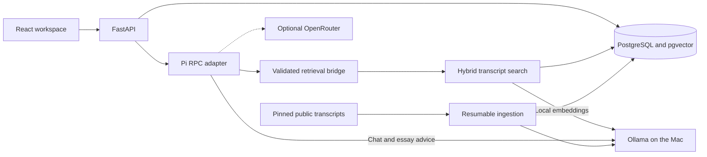
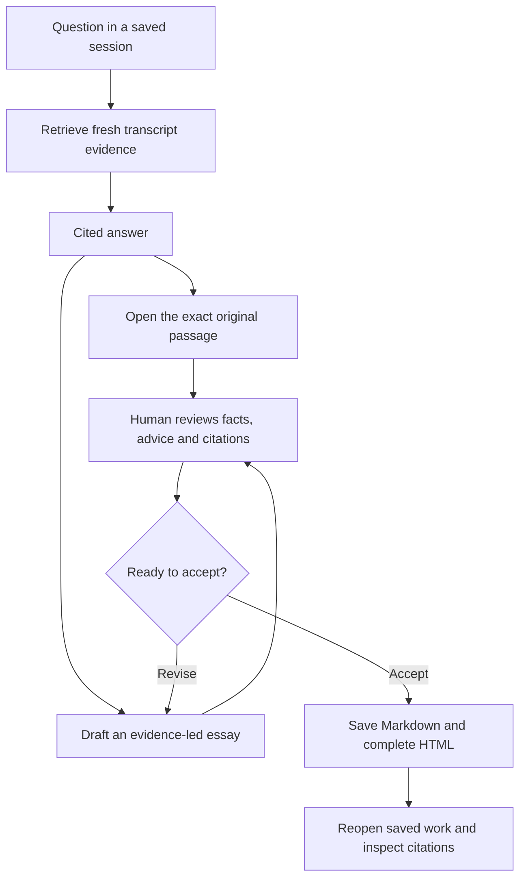

# Lenny Growth Assistant

Lenny helps product managers and growth teams turn **Lenny’s Podcast interviews into evidence they can use**. Ask a focused question, inspect the original transcript behind its citation, and develop a reviewed playbook or essay with Markdown and HTML exports.

The app runs locally on macOS with Ollama, FastAPI, Pi and PostgreSQL. It includes an editorial homepage at `/` and the research workspace at `/workspace`. This public version contains **Chat and essay tools**; experimental Voice Mode and evidence-shortlist branches are excluded.

**Try first:** “How did Sean Ellis change onboarding at Lookout?” Then open its citation. The narrow local workflow has passed; broader answer and autonomous essay quality remain limited. See [verification and limitations](#verification-and-limitations).

## macOS quick start

Prerequisites: **Git, Python 3.11+, curl, Docker Desktop with Compose v2 running, and Ollama installed** with its CLI available. Docker builds install the pinned app dependencies, including Pi 1.5.0; host Node/npm is needed only for frontend development checks. The measured host was an **Apple M2 with 8 GB RAM**: use one generation at a time and expect memory pressure. Cold downloads were not timed.

### 1. Clone and prepare local models

Run these blocks in the same terminal. The first block checks installed models, memory and disk before pulling only missing tags.

```sh
set -eu

git clone https://github.com/vivekvattem/lenny.git
cd lenny

git rev-parse HEAD
open -a Ollama

# Allow the desktop app to start its local server.
for attempt in $(seq 1 30); do
  if curl --noproxy '*' --connect-timeout 1 --max-time 2 -fsS \
    http://127.0.0.1:11434/api/tags >/dev/null 2>&1; then
    break
  fi
  sleep 1
done

ollama list
sysctl hw.memsize vm.swapusage
df -h .

for model in qwen3:0.6b qwen3:1.7b nomic-embed-text:latest; do
  if ! ollama show "$model" >/dev/null 2>&1; then
    ollama pull "$model"
  fi
done
```

Chat uses `qwen3:0.6b`; essay advice uses `qwen3:1.7b`; local retrieval uses 768-dimensional Nomic embeddings. Model tags alone do not establish answer quality. Existing indexes must match the embedding model identity; do not overwrite an index to bypass a mismatch.

### 2. Fetch and verify the pinned transcripts

Fetch before bootstrap so Compose can mount the populated cache read-only. The fetcher refuses to overwrite an existing snapshot; verification checks its Git revision and every manifest source hash.

```sh
export CORPUS_REVISION=be8ab89a890a833cbba2c892178f823fff178c65

if [ ! -d ".cache/corpus/$CORPUS_REVISION" ]; then
  python3 scripts/fetch_corpus.py --revision "$CORPUS_REVISION"
fi

python3 scripts/verify_snapshot.py --root ".cache/corpus/$CORPUS_REVISION"
```

The public snapshot contains **303 episodes**. Downloaded transcripts stay in ignored `.cache/corpus`, not Git. To reuse an existing verified cache, link its entire `corpus` directory into a new checkout **instead of fetching**, before bootstrap; preserve the sibling revision manifest too. An incomplete snapshot should be inspected rather than overwritten.

### 3. Start an isolated Compose project and wait for readiness

This creates a unique project/database and uses separate host ports. If any selected port is occupied, choose another before starting. Existing databases and volumes are preserved.

```sh
export COMPOSE_PROJECT_NAME="lenny_release_eval_$(date +%Y%m%d%H%M%S)"
export POSTGRES_DB="$COMPOSE_PROJECT_NAME"
export WEB_HOST_PORT=18100
export API_HOST_PORT=18101
export DB_HOST_PORT=55440
export DEFAULT_PROVIDER=ollama
export GENERATION_MODEL=qwen3:0.6b
export ESSAY_MODEL=qwen3:1.7b
export EMBEDDING_MODEL=nomic-embed-text:latest
export OLLAMA_URL=http://host.docker.internal:11434
export PRIVATE_RPC_TRACES=false
export OPENROUTER_API_KEY=
export ANTHROPIC_API_KEY=

python3 scripts/bootstrap.py
python3 scripts/wait_ready.py \
  --url "http://127.0.0.1:$API_HOST_PORT/api/health/ready" \
  --deadline-seconds 90 --attempt-timeout 3
```

Bootstrap generates an ignored, mode-0600 `.env` with a database password. **The API entrypoint is the sole migration owner:** Alembic must finish before Uvicorn starts. Do not run a second migration command during startup.

The poll retries connection refusal, empty replies (curl 52), timeouts and not-ready responses. Each attempt is bounded to three seconds, within a 90-second deadline. It succeeds only on HTTP 200 with JSON `status: ready`; failure exits nonzero with the last safe probe summary and an API-log command. Readiness checks dependencies, not answer quality; an empty corpus may still pass foundation readiness, and `product_ready` remains false.

Bootstrap prints the default port 8080 even with overrides. For these settings, use **[localhost:18100](http://localhost:18100)**, **[the workspace](http://localhost:18100/workspace)** and **[API docs](http://localhost:18101/docs)**.

### 4. Index the three demo interviews

This bounded smoke index contains **3 episodes / 112 passages**, not the full corpus. It includes the sources needed by the optional reviewed-essay fixture.

```sh
python3 scripts/docker.py compose exec -T api python -m backend.ingest \
  --root "/corpus/$CORPUS_REVISION" \
  --source-path episodes/sean-ellis/transcript.md \
  --source-path episodes/shreyas-doshi/transcript.md \
  --source-path episodes/shreyas-doshi-live/transcript.md \
  --batch-size 4 --deadline-seconds 900

python3 scripts/wait_ready.py \
  --url "http://127.0.0.1:$API_HOST_PORT/api/health/ready" \
  --deadline-seconds 90 --attempt-timeout 3
```

For full ingestion, or to resume it, omit the source filters. Use one ingestion writer; unchanged committed episodes are skipped and interrupted progress is retained.

```sh
python3 scripts/docker.py compose exec -T api python -m backend.ingest \
  --root "/corpus/$CORPUS_REVISION" \
  --batch-size 4 --deadline-seconds 3600
```

The historical full index reached **303 episodes / 12,770 passages**, with a duplicate-free repeat. That coverage is not automatically present in a fresh database. See [ingestion operations](docs/phase-03-operations.md) and [full-corpus results](docs/phase-10-report.md).

## Try the workflow

1. Open `/workspace`, choose **Start a session**, name it and create it. The composer appears when a session is open.
2. Ask **“How did Sean Ellis change onboarding at Lookout?”** Select Sean Ellis for the narrow demo, or leave all interviews selected for the context check below.
3. Open **S1 · View source**. Compare the answer with the retrieved highlight and stored original passage; closing the source returns focus to its citation.
4. For a prior-message-dependent check, leave **All indexed interviews** selected on both turns and ask **“And what message did those users see after completing that first step?”** The earlier subject should appear in the run’s `resolved_query` and its prior user ID in `context_message_ids`.
5. Choose **Evidence-led essay** to draft. Review every factual excerpt and application before accepting. Save a completed reply or accepted essay through **Documents → Save Markdown / Save HTML**.

The historical question **“What happened with the next cohort?”** also produced a supported answer, but did **not** attach prior message IDs. It is not evidence that general follow-up resolution works.

### Open the reviewed essay fixture

After indexing the three interviews, import this optional fixture **once** into the explicitly named `lenny_release_*` database:

```sh
python3 scripts/docker.py compose exec -T api python -m backend.import_reviewed_fixture \
  --expected-database "$POSTGRES_DB"
```

Open **“Reviewed essay fixture · 1,208 words · 9 manual edits · not fresh generation”**. Expand the essay, then open both document formats. Each preview is labelled **“Reviewed essay fixture · rendering check only.”** The importer validates six source mappings and exact quote hashes, creates a new session and refuses duplicate imports; it makes no model call.

The essay required **nine manual edits: six application-paragraph rewrites and three evidence-span edits**. It demonstrates reviewed document handling, not fresh autonomous essay quality. Its fixture contains the approved final exports and source-span hashes, not full transcript payloads.

With no operation running, restart the isolated app and reopen the saved sessions, citations and both previews:

```sh
python3 scripts/docker.py compose restart api web
python3 scripts/wait_ready.py \
  --url "http://127.0.0.1:$API_HOST_PORT/api/health/ready" \
  --deadline-seconds 90 --attempt-timeout 3
```

Keep the same project environment when reopening this stack. Never use `down -v` or reset a database to repeat a demo.

## System architecture



PostgreSQL owns sessions, source versions/spans, vectors and artifacts. Pi meaningfully drives a narrow retrieval tool and bounded generation; the app agent has no default shell, arbitrary filesystem or web tools. Local inference is the default, with no automatic cloud fallback. See [architecture](docs/architecture.md) and [decisions](docs/decisions.md).

## From question to reviewed artifact



Citation validity and word count are checks, not proof of factual support. Essay facts/citations are assembled on the server; Pi drafts application advice. HTML previews use sanitization, restrictive CSP and a script-disabled sandbox.

## Eight assignment deliverables

| # | Deliverable | Repository location | Current status |
| --- | --- | --- | --- |
| 1 | Complete public source repository | [Backend](backend/), [Pi agent](agent/), [frontend](frontend/), [spike](spike/), [scripts](scripts/), [evaluation](eval/), [Compose](compose.yaml), lockfiles | Published. Credentials, downloaded corpus/models, private traces and local data are excluded. Publication does not establish assignment-quality acceptance. |
| 2 | Runnable README | This file; [troubleshooting](docs/troubleshooting.md), [handoff](docs/handoff.md) | Local startup and bounded demo verified as described below; cold-machine installation is not a measured result. |
| 3 | Product requirements document | [PRD](docs/PRD.md), [scenarios](docs/scenarios.md), [assumptions](docs/assumptions.md), [risks](docs/risks.md) | Present, including discovery and measured failures; no customer-approval claim. |
| 4 | Design documentation | [Design](docs/design.md) | Present: homepage, workspace, responsive panels and source/artifact inspection. |
| 5 | Architecture documentation | [Architecture](docs/architecture.md), [decisions](docs/decisions.md), diagrams above | Present: framework boundary, retrieval, persistence, local/cloud and artifact isolation. |
| 6 | Sanitized coding-agent transcripts | [Transcript index](docs/agent-transcripts/README.md), [publication/redaction notes](docs/agent-transcripts/PUBLICATION.md) | **Partial.** Genuine command metadata and phase reports are available; a complete sanitized conversation export is still missing. Summaries are not reconstructed dialogue. |
| 7 | Automated tests and manual UI plan | [Backend tests](backend/tests/), [agent policy tests](agent/test_provider_policy.ts), [frontend tests](frontend/test-source-span.mjs), [test plan](docs/test-plan.md) | Tests and manual procedures present. Unit/mock, real PostgreSQL and live model evidence are separate; quality acceptance is still limited. |
| 8 | 2–3 minute camera-enabled YouTube demo | [Demo script](docs/demo-script.md), [submission checklist](docs/submission-checklist.md) | **Pending recording, upload and evaluator-access verification.** Screen rehearsal is not a completed camera demo. |

The [requirement register](docs/requirements.md) and [repair checklist](docs/submission-checklist-repair.md) retain the detailed gaps. Phase reports, checklists and publication manifests describe their historical revisions; their old “publication pending” entries do not override the current public repository status.

## Verification and limitations

Latest maintainer verification used public runtime revision **[`ad4eff0`](https://github.com/vivekvattem/lenny/commit/ad4eff0da66e7be38b989d19a6c5af633d03cb27)** on 9 November 2026, with Pi → local Ollama `qwen3:0.6b`, real PostgreSQL and isolated Chrome 157. The smoke database held **3 episodes / 112 passages**. Its exact-revision receipts are retained outside the repository; this README-only edit does not rerun or extend those tests.

| Check | Verified outcome |
| --- | --- |
| Startup, API-owned migration and bounded readiness | Passed on fresh isolated volumes. |
| Onboarding question and next-cohort answer | Both completed with supported citations; original passages opened. The next-cohort wording alone did not prove prior-message use. |
| Genuine prior-message use on `ad4eff0` | Passed for the unscoped follow-up in the workflow above: prior user ID and subject present in the trace, fresh retrieval, supported answer. General follow-up handling remains incomplete. |
| Reviewed essay and Markdown/HTML previews on `ad4eff0` | Passed with review label, six sections, valid citations and unchanged export hashes; **nine manual edits disclosed**. |
| Restart/reopen on `ad4eff0` | Passed after stopping/starting all three isolated services; saved messages, citations and artifacts matched their snapshots. |
| Final camera-enabled demo recording | **Pending.** No uploaded video or submission receipt is claimed. |

Important remaining limits:

- **Historical scenarios: original 0/5; bounded rerun 0/5; proposed target 4/5.** No newer five-scenario score replaces them. [Phase 10 results](docs/phase-10-report.md).
- The fresh, unedited **1,145-word essay failed semantic/readability review** despite valid IDs and structure. The reviewed 1,208-word fixture is a different result. The 1,125–1,375-word band is our operational interpretation of “approximately 1,250,” not a company-set threshold. [Claim review](docs/agent-transcripts/phase-12-repair/essay-review.json).
- LNO, multi-part completeness, abstention and general context remain unresolved. Full-index hybrid Recall@8 was 56.25% tuning / 81.25% previously observed held-out, below the proposed 85% target. Citation existence is not support.
- Two transient readiness 503s occurred under load when the Pi version probe exceeded its three-second deadline; readiness recovered. The independent export/restart checks and subsequent saved-context reopen had no page/console errors. The combined test’s earlier console failure remains recorded separately.
- Chat selects one bounded exact excerpt, with a 4,096-token context and 128-token output cap. This is a local evaluator tool, without production authentication or a general synthesis-quality guarantee.

## Configuration, tests and diagnostics

[`.env.example`](.env.example) documents server settings. Keep real keys only in ignored `.env`; never commit credentials, the confidential assignment PDF or private evidence.

OpenRouter is optional and must be selected explicitly through server configuration (`DEFAULT_PROVIDER=openrouter`, `OPENROUTER_API_KEY`, `OPENROUTER_MODEL`), followed by recreating the intended API service. The UI discloses the active provider/model; there is no interactive provider picker in this revision. For cloud setup, remove the quick start’s empty shell key override before relying on `.env`. Selected evidence, context and instructions then leave the machine. Cloud validation is separate from the local quick start: [historical Gemini check](docs/phase-09-openrouter-diagnosis.md), [GPT-OSS token-cap check](docs/openrouter-120b-output-cap-test.md). Only the final `openai/gpt-oss-120b` turn after linked retrieval gets 1,024 tokens; tool-call and local turns retain their limits. Current cloud credits/availability are not revalidated.

Run checks separately from restart/outage exercises:

```sh
python3 -m unittest scripts.test_wait_ready -v
node --test agent/test_provider_policy.ts agent/test_conversation_policy.ts agent/test_essay_format.ts

# Creates and retains a separate contract database on this isolated server.
python3 scripts/docker.py compose run --rm --no-deps \
  -e DEFAULT_PROVIDER=ollama -e OPENROUTER_API_KEY= -e ANTHROPIC_API_KEY= \
  api python -m backend.contract_check

# Frontend development checks require Node 24.9.0/npm on the host.
npm ci --prefix frontend --ignore-scripts --no-audit --no-fund
npm --prefix frontend run typecheck
npm --prefix frontend run build
node --test frontend/test-source-span.mjs
```

For a failed startup or ingestion, inspect the intended project without resetting it:

```sh
python3 scripts/docker.py compose ps
python3 scripts/docker.py compose logs --tail 80 api
```

The readiness response can be successful before ingestion; inspect corpus counts too. Resume interrupted ingestion with the same command. Model/RPC failures are operational failures, not evidence gaps. See the [test plan](docs/test-plan.md), [known issues](docs/known-issues.md) and [handoff](docs/handoff.md) for broader evaluation and recovery details.
